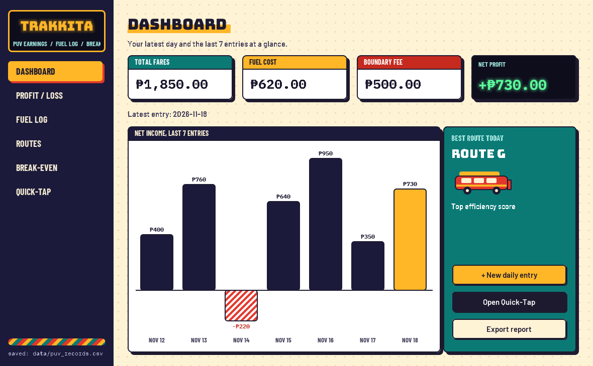
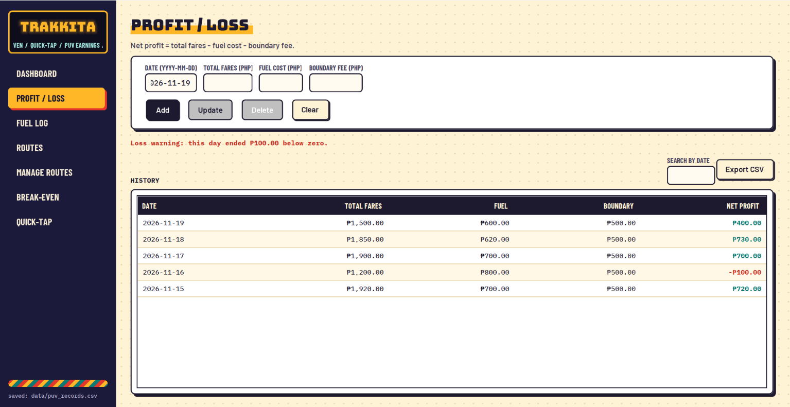
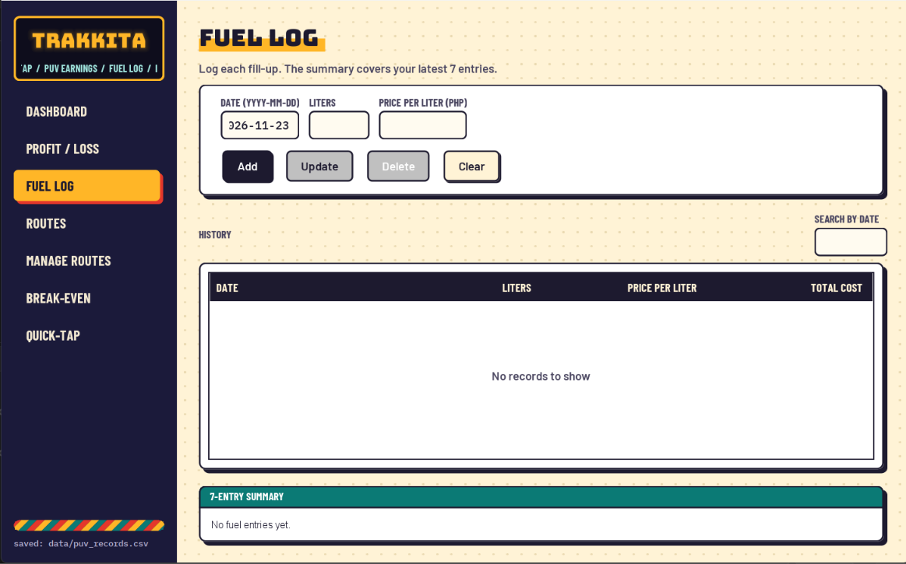
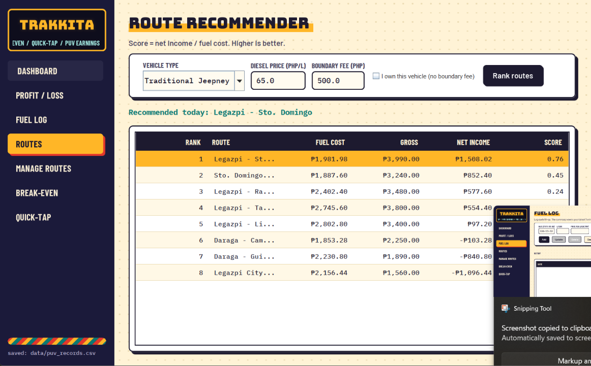
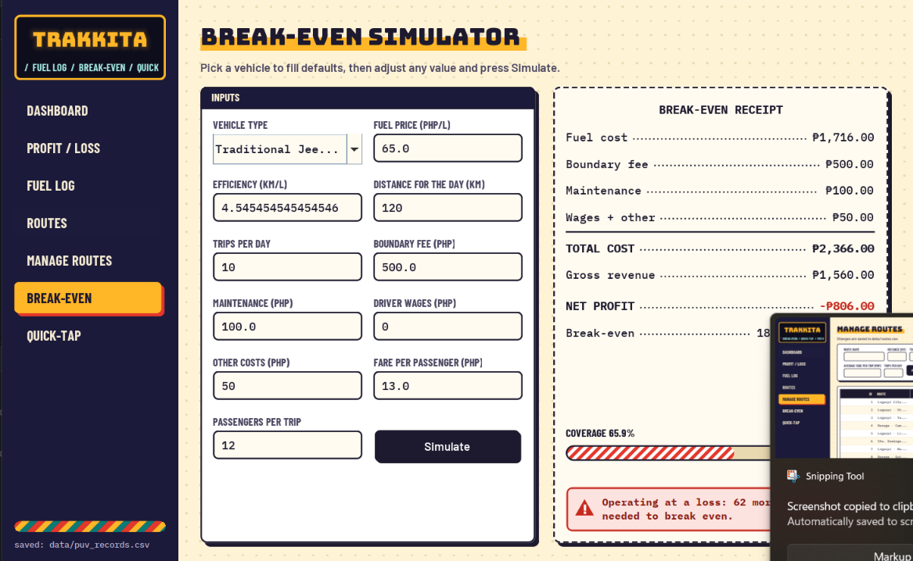
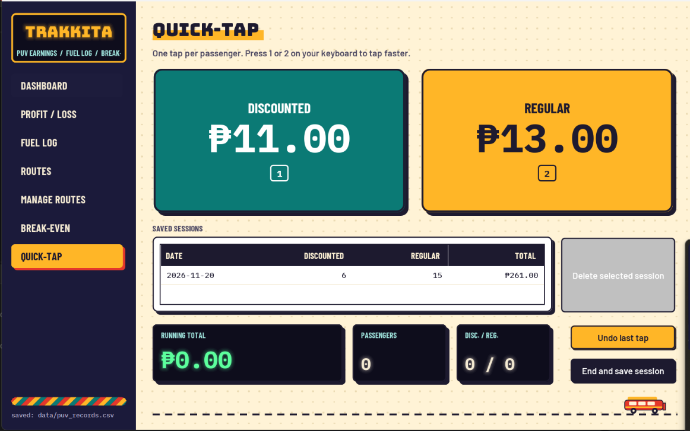

# TrakKita (Java Edition)

TrakKita is an offline desktop tracker for public utility vehicle (PUV) drivers. It records daily fares and costs, fuel purchases, Quick-Tap fare sessions, and route estimates. The application uses Java Swing and CSV files; it has no third-party runtime dependencies.

## Features

- **Dashboard:** latest daily totals, recent net income chart, and the recommended route.
- **Profit / Loss:** daily fares, fuel cost, and boundary fee with net profit, date filtering, duplicate-date replacement, and CSV export.
- **Fuel Log:** fuel entries with a seven-entry summary and date filtering.
- **Routes:** route ranking using the selected vehicle's fuel consumption, diesel price, and boundary fee. The route data matches the original C application's eight Legazpi-area route seeds.
- **Manage Routes:** add, edit, and delete routes stored in `data/routes.csv`. Missing or unusable route files fall back to the built-in routes.
- **Break-Even:** estimate fuel cost, total cost, break-even passenger count, and net profit.
- **Quick-Tap:** count regular and discounted fares with the mouse or `1` / `2` keys, undo the last fare, save session history, and send a session total to Profit / Loss.
- **CSV storage:** earnings, fuel records, and tap sessions are stored in `data/puv_records.csv`.

## Screenshots

| Dashboard | Profit / Loss | Fuel Log |
|---|---|---|
|  |  |  |

| Routes | Break-Even | Quick-Tap |
|---|---|---|
|  |  |  |

## Requirements and launch

- Windows with JDK 17 or newer.
- Run `build.bat`, then `run.bat`, from the `TrakKita-Java` project folder.
- Keep the working directory at the project folder so the app can load `fonts/` and use `data/`.

`build.bat` compiles every Java source file into `out/` with UTF-8 encoding. `run.bat` launches `trakkita.Main` from that output folder.

## Data files

`data/puv_records.csv` uses one record per line:

```text
EARNING,date,totalFares,fuelCost,boundaryFee
FUEL,date,liters,pricePerLiter
TAP,date,discountedTaps,regularTaps
```

Malformed record lines are skipped with a startup warning. `data/routes.csv` uses:

```text
id,name,distanceKm,trafficFactor,avgFarePerTrip,tripsPerDay
```

The route manager writes this file when the user saves a route change. The app uses the built-in route list if the file is missing or every row is invalid.

The four vehicle fuel-consumption values and route seeds are taken from the original C route recommender. The Java project also contains Provincial Bus as an additional Java-only preset; the C source does not define matching bus assumptions. Vehicle capacity and maintenance values are not inputs to route ranking.

## Project layout

- `src/trakkita/model`: PUVs, routes, earnings, fuel entries, and tap sessions.
- `src/trakkita/service`: application context, repositories, route ranking, and break-even calculations.
- `src/trakkita/storage`: CSV data storage and load results.
- `src/trakkita/gui`: Swing screens and shared UI helpers.
- `src/trakkita/gui/widget`: custom painted theme components.
- `src/trakkita/exception`: validation and data exceptions.
- `src/trakkita/util`: validation and money formatting.
- `docs/requirements.md`: project requirements analysis.
- `docs/class-diagram.puml`: source-traced PlantUML class diagram.

Bundled fonts and their license files are in `fonts/`.

## OOP concepts

- **Abstraction and inheritance:** `LogEntry` and `PUV` define shared parent types.
- **Polymorphism:** PUV subclasses provide vehicle-specific fuel and operating defaults.
- **Encapsulation:** model fields are private and validated through constructors or setters.
- **Interfaces:** `Persistable`, `Reportable`, and `DataStore` separate shared behavior from concrete storage.
- **Generics:** `EntryRepository<T extends LogEntry>` stores typed records.
- **Exceptions:** input and damaged-data conditions use domain-specific exceptions.
- **File handling:** CSV data loads with per-line recovery, and saves through a temporary file before replacement.
- **Facade:** `AppContext` provides the GUI with shared repositories and services.
